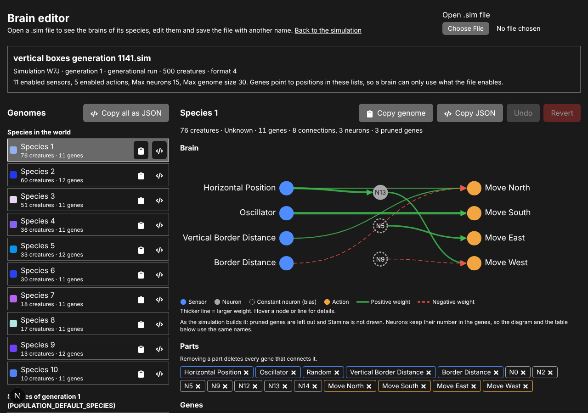

# Brain editor

The brain editor is a separate page, `/brain-editor`, linked under **Scenario → Load scenario → Load .sim file**. It is also a single file, [public/brain-editor.html](../../public/brain-editor.html), that works without the app: see [Standalone file](#standalone-file). It opens a `.sim` file, shows the brain of each genome in it, lets you change the brains gene by gene, and saves the result as a new `.sim` file. It also copies genomes, to start a run with them (see [Default Species](../reference/population-and-selection.md#default-species-defaultspeciespopulation)).

The file is read in the browser and is never changed: the edited copy is a download. Load it in the app with **Load .sim file**.

The code is in [components/brain-editor/](../../components/brain-editor/), with the engine helpers in [genomeEditing.ts](../../simulation/creature/brain/genomeEditing.ts) and [genomeFile.ts](../../simulation/serialization/genomeFile.ts).

## Opening a file

**Open .sim file** accepts the same files as **Load .sim file**. Files of older versions are first brought to the current format, as the app does when it loads them, so the genes are read with the sensors and actions the app would use. The box under the title shows the simulation code, the generation, the number of creatures, and what the genes can point to: the enabled sensors and actions and **Max neurons**. A brain can only use the sensors and actions the file enables; to use others, change them in [Sensors, actions and Max neurons](#sensors-actions-and-max-neurons).

## Sensors, actions and Max neurons

This section (closed until you open it, or while the lists differ from the file) has a checkbox for every sensor and action, in the order of the tables in the code, and the **Max neurons** of the file. Next to each enabled one is the number of genomes with a gene that uses it. Changes are shown in bold until you click **Apply**; **Discard changes** drops them.

Genes point to positions in the enabled lists and take neuron numbers modulo Max neurons (see [gene encoding](../reference/sensors-and-actions.md#gene-encoding)), so changing the lists would rewire every brain. **Apply** rewrites every genome of the file, edited or not, the same way **Update simulation** does in the app ([geneTranslation.ts](../../simulation/creature/brain/geneTranslation.ts)), so that each brain stays the same, except that:

- the genes of a sensor or action you disable are deleted (a genome that would lose all of them keeps its first gene);
- a neuron that is not below the new Max neurons connects to another neuron.

Before applying, a message says how many genomes would get another brain and how many genes would be deleted. Species keep their ids, as in the app. Disabling and enabling a sensor again does not bring its genes back: use **Undo last apply**, which goes back to the lists, genomes and edits before each Apply. At least one sensor and one action must stay enabled, and Max neurons goes from 1 to 128 (genes hold 7-bit neuron numbers).

The new lists are saved with the file. With metabolism, a sensor or action enabled here has no cost (`SENSOR_COSTS`, `ACTION_COSTS`) until you set one in the app. Check also that the population strategy still has what it needs: *Random Fixed Genera*, for example, needs the main action of each genus (Photosynthesis, Attack), and continuous runs need Reproduction.

## Genomes

The list on the left has every genome of the file, in groups:

| Group | What it is |
|---|---|
| Species in the world | The species of a file saved during a run, largest first, with their number of creatures |
| Genomes that start the generation | The genomes of a *Save generation* scenario, with how many creatures carry each |
| Species of generation 1 | The entries of `POPULATION_DEFAULT_SPECIES`, used by the *Default Species* strategy |
| Plant genes | The plant genes of the *Plants and Animals* strategy |

Each genome shows its color (the same as in the app), its genes and its genus (plant or animal, from its brain), and an **edited** mark once it is changed. Two buttons copy it:

- **Copy genome** (clipboard icon) copies the genes in hexadecimal, as the Population and Scenario tabs copy them.
- **Copy JSON** (code icon) copies it as an entry of `POPULATION_DEFAULT_SPECIES`, for example `{"name":"vertical boxes #3","genome":[…]}`, to paste inside that list in *Scenario → Constants*.

**Copy all as JSON** copies the whole list, with the edits, as a complete `POPULATION_DEFAULT_SPECIES` value.

## The brain

Clicking a genome shows its brain with the same diagram as the Population tab. It is built exactly as a creature builds it at birth (see [brain](../model/brain.md#building-the-network)): genes whose neuron has no way to an action are pruned, and Stamina genes are not drawn. One difference: neurons keep the number they have in the genes (N3, N12…), where the Population tab numbers the neurons left after pruning from N0. So the diagram and the gene table use the same names.

The line above the diagram gives the genus, the number of genes, connections and neurons, the pruned genes, the stamina (with the Stamina action) and the think cost per step (with `SENSOR_COSTS` or `ACTION_COSTS`). A genome longer than **Max genome size** is marked: it still works, but mutation never makes it longer.

## Editing

Every change applies at once and redraws the brain. **Undo** goes back one change (moving a weight slider counts as one change), and **Revert** goes back to the genes of the file.

- **Parts** lists every sensor, neuron and action that some gene uses, also the pruned ones. The × of a part deletes every gene that connects it.
- **Genes** is one row per gene: where it comes from (a sensor or a neuron), where it goes (a neuron or an action), its weight, its role, and the gene in hexadecimal. Change the source and target in the lists, and the weight with the slider or the number field (from −4 to almost +4, kept in steps of 1/8192, as genes store it). The trash button deletes the gene. The role is *used*, *pruned* (the brain leaves it out) or *stamina*. A Stamina gene only has a weight: it gives the share of steps in which the brain runs, and only the first one counts. A genome without a Stamina gene gets a new one when its creatures are born.
- **Add a connection** adds one gene. Adding a sensor or an action is adding a connection from that sensor or to that action.
- **Add a neuron** adds the lowest neuron number that no gene uses, with two genes: one from the chosen source into the neuron and one from the neuron to the chosen target. It is disabled when every number below Max neurons is used.
- **Replace the genes** replaces the whole genome with a pasted one: genes in hexadecimal, a JSON list of numbers, or a JSON entry with `genome` (what the copy buttons give). It is read with the sensors and actions of this file, so a genome copied from a file with other enabled lists gets another brain.

A genome always keeps at least one gene: a change that would delete all of them is refused with a message.

## Saving

**Save .sim file** downloads the file with the edits and the applied sensors, actions and Max neurons, named `<file> edited.sim` unless you change the name. Everything else in the file is kept as it was, in the current format (indented when `PRETTIFY_OUTPUT_TO_FILE` is set).

An edited species becomes a new species that comes from the one it was, as after a mutation: its id is computed from the new genes and the old id, its parent is the old id, and its first generation is the generation of the file (see [species](../reference/log-file.md#species)). Its creatures keep their positions, mass and age.

Loading the saved file resumes the run with the edited brains. A file saved at the start of a generation (*Save generation*) starts it with the edited genomes, and edited `POPULATION_DEFAULT_SPECIES` are used the next time a run starts with the *Default Species* strategy.

## Standalone file

[public/brain-editor.html](../../public/brain-editor.html) is the same editor in one HTML file, with its code and styles inside. Open it from disk (double click, `file://`) or send it to someone: it needs no server and no network, and works the same as the page of the app, except that it has no link back to the simulation. The app also serves it at `/brain-editor.html`.

It is generated, so do not edit it. `npm run build:brain-editor` builds it again from the code ([scripts/build-brain-editor.ts](../../scripts/build-brain-editor.ts)): esbuild bundles [standalone.tsx](../../components/brain-editor/standalone.tsx) (React, the editor components and the engine code they use) and Tailwind builds the CSS from `styles/globals.css` with the classes of the editor files only. Run it after changing the editor or the engine code it uses (genes, brains, sensors and actions, the save format): the test `brainEditorHtml` fails while the file is out of date.

When the browser refuses the clipboard (as some do for `file://` pages), the copy buttons copy through a hidden text field instead.
