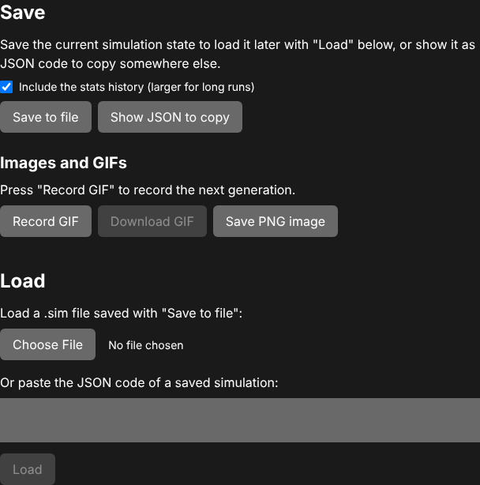
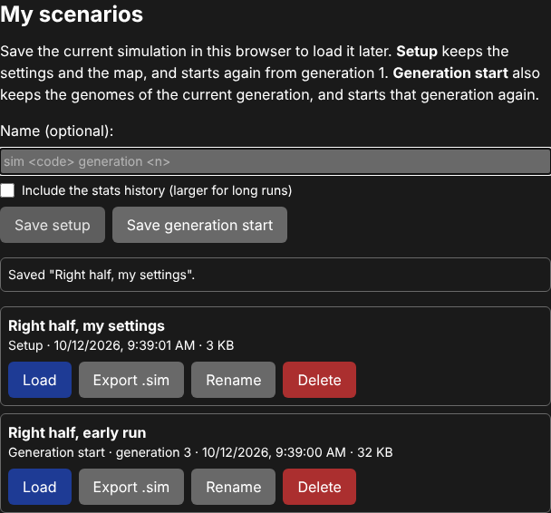

# Files: save, load and export

## My scenarios

Your own scenarios, stored in this browser. They are separate from the scenarios in the **Start** tab, which are part of the app.

- **Save setup** stores the settings and the map. Loading it starts a new run from generation 1, like the scenarios in Start.
- **Save generation start** also stores the genomes of the current generation, as they were when the generation started. Creatures that died since then are included. Loading it starts that generation again: the same genomes, without mutation, placed like in generation 1 (around the spawn area if there is one, otherwise at random). The generation number and the simulation code are kept.
- **Include the stats history** adds the fitness history of every previous generation. A long run has one row per generation, so this is most of the size. Without it, the Stats charts start empty from the loaded generation.

Positions, ages, mass and health are not stored. Give the scenario a name, or leave it empty to use `sim <code> generation <n>`.

Each saved scenario has **Load**, **Export .sim** (downloads it as a file that **Load** below also accepts), **Rename** and **Delete**.

Scenarios are stored in the browser's IndexedDB. They are lost if you clear the site data, and they are not shared between browsers or devices: use **Export .sim** to keep a copy.

- **Save to file** downloads the whole simulation as `sim <code> generation <n>.sim`: settings, map, creatures, species and stats.
- **Show JSON to copy** shows the same content as text, so you can paste it into a message or an issue.
- **Include the stats history** (on by default) adds the fitness history of every generation. In a long run it is most of the file. Without it the file is much smaller, and the Stats charts start empty when you load it.

A saved file is plain JSON. You can open it in a text editor to change values that are not in the UI, such as the metabolism constants (see [parameters](../reference/parameters.md#not-in-the-ui)).

## Load

- **Choose File** loads a `.sim`, `.txt` or `.json` file saved with **Save to file**. Files from older versions of the app, such as those in `_scenarios/`, may not load: if one fails, the message explains why.
- **Or paste the JSON code** loads text you copied with **Show JSON to copy**. Click **Load**.

Loading **resumes** the saved run: it continues from the saved generation with the saved creatures. The Settings draft and the footer controls are updated to match. A message tells you whether the load worked or why it failed.

## Images and GIFs

- **Save PNG image** downloads the current picture of the world as `sim<generation>.png`.
- **Record GIF** records the **next** generation, from its first step to its last. While it records, the button shows how many steps have been captured. When the generation ends, click **Download GIF**. Rendering a long generation can take a while.

Tip: set **Pause between steps** to 0 and **Immediate steps** to 1 while recording. Every step is then a frame, and the GIF does not take longer to record than it needs to.
