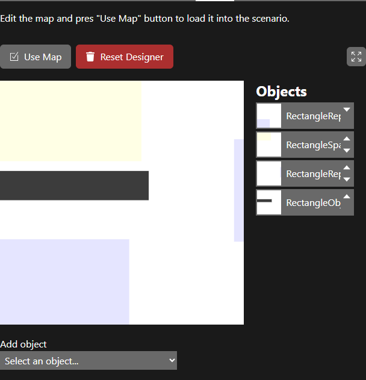

# Map editor

The map editor is the **Map** section of the **Scenario** tab. It is where you draw the world: obstacles and areas.

## Object types

Choose a type in **Add object** to create a 20% × 20% object in the top-left corner.

| Object | Effect |
|---|---|
| Rectangle, Ellipse | **Obstacle.** Creatures cannot enter it. The touch sensors detect it. |
| Rectangle Reproduction, Ellipse Reproduction | **Reproduction area** (blue). With the *Inside Reproduction Area* selection method, creatures standing here when the generation ends survive. With any other selection method, or in a continuous run, it has no effect, and the simulation canvas does not draw it (the map editor still does). |
| Rectangle Spawn | **Spawn area** (yellow). With the *Asexual Zone* population strategy, new creatures are placed here. Use only one: if there are several, only the one furthest back is used. |
| Rectangle Health, Ellipse Health | **Health area.** Drawn green for a positive **Health** value and red for a negative one. **It currently has no effect:** the code that applies it is disabled (see [World](../model/world.md#objects-and-areas)). |

## Editing

- **Select** an object by clicking it on the canvas. A white outline marks it, and its properties appear on the right. Where objects overlap, the click selects the one on top; click again on the same spot to select the one below it, and so on. Clicking an empty spot clears the selection.
- **Move** an object by dragging it on the canvas. Dragging an object that is not selected selects it first.
- **Resize** the selected object by dragging the handles at its corners and edges.
- **Fine-tune** it with **X**, **Y**, **Width** and **Height** on the right. Values are fractions of the world size: 0 is the top or left edge and 1 is the bottom or right edge. Positions snap to whole cells.
- **Clone** duplicates the selected object. **Delete**, or the Delete key, removes it.
- **To front** and **To back** change the drawing order: the object is drawn on top of, or below, all the others. New objects are drawn on top. The order also decides which spawn area is used: only the one furthest back counts.
- The **fullscreen** button (top right) gives you a bigger canvas.

## Applying the map

The editor shows the map of the Scenario draft, drawn at the draft's world size. When you load a scenario, a file or one of **My scenarios**, it shows that map.

Your edits are part of the draft, like the other Scenario settings: the bar at the top of the tab says that there are changes not applied yet, and you apply them with its buttons (see [Applying changes](settings-and-stats.md#applying-changes)):

- **Update simulation** sends the map to the running simulation. The creatures and the generation count are kept, so the population has to adapt to the new world. Creatures standing where a new obstacle is placed are removed.
- **Restart** starts again from generation 1 with the new map.
- **Discard changes** throws away all the draft changes, the map included.

Two buttons above the map work on the map only:

- **Reset map** throws away your map edits and goes back to the map of the running simulation. Other draft changes are kept.
- **Clear map** removes every object.

To keep a map, apply it and then save the simulation or the scenario from the [Export](export.md) tab: they save the running simulation, not the draft.
