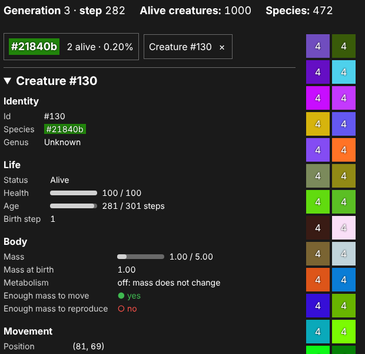
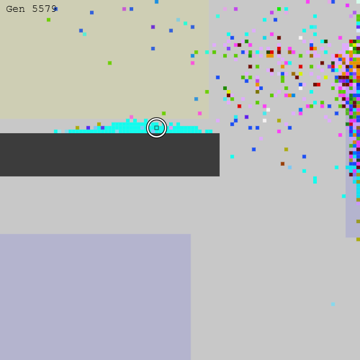
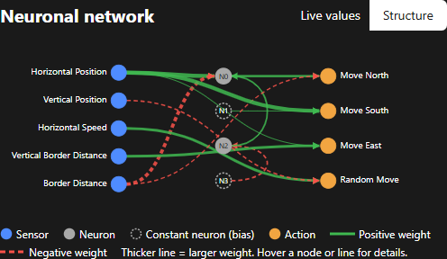
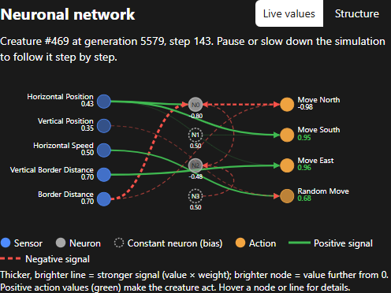
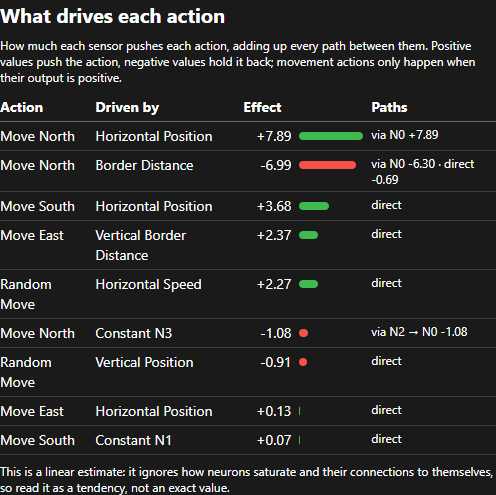

# Population and brains

The **Population** tab shows what is alive and how it thinks.

## Summary line

The line at the top shows how many creatures are alive and how many species there are. In scenarios with plants and animals it also counts the creatures of each genus. Everything is live except the number of species, which is counted at the start of each generation.

## Animals

Below the summary line, three indicators describe the animals of the last generation that ended. They change only when a generation ends, and are hidden until then or if the generation had no animals to report.

- **Largest genome**: the largest genome among the animals alive at the end of the generation, in genes, and the colour code of its species. If several species have that size, the one with most creatures is shown.
- **Average genome**: the average genome size of those animals, counting each creature.
- **Most deaths of old age**: the animal species with most deaths of old age during the generation, how many, and its genome size. If species tie, the first to reach that number is shown. In generational runs creatures only die of old age when **Maximum age** is shorter than the generation; otherwise this shows **none**.

## Species

A **species** is a lineage: creatures with the same genome that come from the same species. A child born with exactly its parent's genome stays in its parent's species; a child with a mutation starts a new species, which remembers the species it came from. So two species can have the same genome, and then they also have the same colour. Each species has an id of 16 hexadecimal digits, shown next to it and used by the [log](settings-and-stats.md#log) ([details](../reference/log-file.md#species)). Each species is shown with the same colour as its creatures on the world, so it follows the phenotype mode: with `genome` each species has a colour taken from its genome, and with `trophicLevel` it is a shade of green, blue or red for its genus, and with `greenPlants` plants are shades of green and the other species have their own non-green colour.

- The coloured boxes on the right are the first 42 species in the chosen order, counted at the start of the generation. Each box shows how many creatures the species has. A small letter in the corner shows the genus: **P** plant, **H** animal (no letter for `unknown`). Hover a box to see its colour code, genus, number of creatures and genome size.
- Click a box to select that species. One of its living creatures is selected too, with a ring around it in the world, so the live values of its network are shown. If the selected creature already belongs to that species, it stays selected. Click the box again to clear both the species and the creature.
- **Filter species by** shows only the species whose network uses a given **Sensor** and/or **Action**: the ones with at least one connection from that sensor or to that action, as drawn in the network diagram. The lists contain the enabled sensors and actions. With both set, a species must use both. A line below says how many species match; the boxes show the first 42 of them in the chosen order. **Clear filter** sets both back to **Any**. The filter only hides boxes: it does not change the selection.
- **Order species by**, below the filter, sorts the boxes by **Number of creatures** (the default) or **Genome size**, largest first. Species with the same genome size are sorted by number of creatures.

Many species in the list have the same colour (in `trophicLevel` mode, species of the same genus have similar shades) and the same count. Usually these are close relatives that differ by one mutation.

## Selecting a creature

Click a creature in the world. This selects its species and draws a ring around it. Clicking an empty cell clears the creature and species and [selects the cell](#selected-cell) instead.

When a new generation starts, the selection moves to a creature of the same species. Offspring often mutate, so the species may have no members in the new generation. In that case the creature that shares the most genes with the old one is selected, usually a descendant with a single mutation, and its species becomes the selected species.

To select a creature by its id, type the id in **Select creature id**, below the summary line, and press **Select** or Enter. If a creature with that id is alive, it is selected as if you had clicked it in the world. Ids can restart every generation, so in continuous runs, where creatures of several generations live together, the youngest creature with that id is selected.

If no living creature has that id, the simulation waits for it: a message under the field says so, and when a creature with that id is born it is selected and the simulation pauses. **Stop waiting** cancels this, and so does selecting another creature (clicking it in the world, a species box, or the buttons under **Creature #id**). The field is emptied once the creature is selected or the wait is cancelled. The wait survives a restart, so you can type an id and then press **Restart**.

Pause the simulation, or set **Pause between steps** to 200, before you click. The creature you click is the one whose live values appear below. To choose a specific creature of a species, click it in the world instead of the species box. To clear only the creature and keep the species, use the **×** next to its name at the top of the panel.

## Layout of the panel

The top of the panel shows what is selected: the species (colour code, genus, alive creatures and percentage) and the creature, or the cell. Below it, the information is grouped in sections that you can open and close by clicking their title:

| Section | Shown when | Open at first |
|---|---|---|
| **Species stats** | a species is selected | yes |
| **Creature #id** | a creature is selected | yes |
| **Cell (x, y)** | an empty cell is selected | yes |
| **Neuronal network** | a species is selected | yes |
| **What drives each action** | a species is selected | yes |
| **Genome** | a species is selected | no |

A section you close stays closed when you select another species.

## Species stats

The selected species, with the same groups as a [selected creature](#selected-creature) so the two can be compared. Every member has the same genes, so what comes from the genes is shown once; the rest are averages, so species of different sizes can be compared. Each group says in its title which creatures it averages. The section is updated while the simulation runs:

- **Population**: the living creatures out of those of this generation, how many there were when the generation (or time window) started, how many were born since, and how many have died since. These are counts, to show how many creatures are behind the averages.
- **Life** (average of the living): health and age.
- **Body**: the average mass of the living; the mass at birth, basal consumption and thinking cost, which are the same for every member; and the share of the living with enough mass to move and to reproduce.
- **Movement** (average of the living): distance index and steps without moving.
- **Activity** (average per creature, dead or alive): children, and for animals attacks and kills, with the kills of plants and of other animals apart.
- **Mass balance** (average per creature, dead or alive; with metabolism): the average of each line of the creature's mass balance. Since the balance is a sum, the averages add up too: the last line is the average of the mass of the living and the mass the dead had when they died. Food from plants and food from other animals are shown apart, as for a single creature.
- **Deaths**: the average age of the dead when they died, and the share of the deaths of each cause. Creatures still alive are not included, so while a species is young this age is low even if it lives long.
- **Brain**: the genes split by what they cost, neurons, connections and stamina, the same for every member.

Young creatures have had less time for the per creature averages, so compare species of a similar average age.

Above the stats, a line says where the species comes from: a root species (from a random or loaded genome), or the id of the species it came from and the generation it appeared in. **Select parent species** selects that species, while it has living creatures. **Mark for log**, at the top, marks the species for the log (*Simulation → Log*, **Marked in Population**).

## Selected creature

At the top of the **Creature** section there are some buttons:

- **◀ ▶** select the previous or next living creature of the same species (ordered by id). The text between them says which one you are looking at, for example "2 of 5 in its species".
- **Select parent** selects the creature its genome was copied from, and that creature's species, since a mutation may have made the child a new species. It is only enabled while the parent is alive. In generational runs the parents are replaced when the generation ends, so this is mostly useful in continuous runs or for children born by the Reproduction action.
- **Mark for log** marks this creature for the log (*Simulation → Log*, **Marked in Population**). A creature is marked by its key, birth generation and id, so the mark follows this creature and not others that get its id in later generations.

The section is updated at every step:

- **Identity**: id, species (colour code and id), genus and its parent (id and the generation the parent was born in; most selection methods restart the ids every generation).
- **Life**: alive or dead, health, age against the maximum age, and the generation and step it was born. In generational runs the maximum age is the length of the generation, or **Maximum age** if it is shorter.
- **Body**: mass against the maximum mass, mass at birth, basal consumption per step and thinking cost (what the sensors and actions of its brain cost in each step it thinks). "Enough mass to move / reproduce" tell whether the creature has the mass that each action needs (attacking needs none) ([Creatures](../model/creatures.md)). Without metabolism the mass never changes.
- **Movement**: position, last movement, direction, the distance index used by *Greatest Distance* selection (it is not the number of cells travelled), steps without moving, and the water in its cell.
- **Activity**: children, and for animals attacks and kills, with the kills of plants and of other animals apart.
- **Mass balance** (with metabolism): where its mass came from and went since it was born, as a sum. It starts from the mass it got at birth, adds the water from photosynthesis and, for animals, the mass eaten from plants and the mass eaten from other animals on separate lines, all as the mass gained after the [assimilation efficiency](../model/creatures.md#assimilation-efficiency) (the line of animals also gives the net of all the food: eaten from plants and animals minus what attacking cost), and takes away the basal consumption of its genes, the actions (thinking, moving and attacking) and reproduction (the cost of the attempts and births, and the birth mass given to its children). The last line is the result, which should be its mass; if it is not, its real mass is shown in red. For a dead creature it is the mass it had when it died. A creature loaded from a file starts from the mass it had when it was saved.
- **Brain**: genes, split by what they cost every step (the primary genes, the free Stamina gene and the others; see [Mass and metabolism](../model/creatures.md#mass-and-metabolism)), neurons and connections, the stamina and how many steps the brain has run (see [Stamina](../reference/sensors-and-actions.md#stamina)), and the action with the highest output in this step.

If the creature dies, the section says why (old age, out of mass, eaten and by which species, or health), when, and keeps the values of its last step. In generational runs most creatures do not die: they are replaced when the generation ends, and the section says so.

See [Life history](../model/creatures.md#life-history) for what each value counts.

## Selected cell

Click an empty cell, or an obstacle, in the world to select it. A square marks it, and the **Cell (x, y)** section shows, updated at every step:

- **Contents**: empty, obstacle, or the creature that has moved into it since. Click the creature to select it.
- **Map objects**: the obstacles and areas (reproduction, health, spawn) that cover the cell.
- **Water**: the water in the cell against its capacity ([World](../model/world.md)).

Selecting a creature or a species box clears the cell. To clear it yourself, use the **×** next to its name at the top of the panel.

## Selected species

- **Alive / percentage**: how many members of the species are alive now and their share of all the living creatures. Unlike the boxes, it is live, so it also counts species born during the generation (continuous runs). With **Immediate steps** at 20 or 200 it is recounted only when the world is redrawn, because counting compares the genes of every creature. If every member has died, it shows **Extinct**.
- **Neuronal network**: the brain shared by every member of the species. With the Stamina action enabled, a line above the diagram gives the species' stamina and which gene sets it, or says that it has no Stamina gene and takes `STAMINA_DEFAULT`. Stamina genes are not connections, so the diagram does not draw them (see [Stamina](../reference/sensors-and-actions.md#stamina)).
- **What drives each action**: a summary of the network.
- **Genome**: genome size, the stamina line (with the Stamina action enabled) and the raw genes in hexadecimal and binary. Use the clipboard button to copy them.

### Neuronal network: Structure view

The diagram reads from left to right:

- **Blue nodes** are the sensors the genome uses (see [sensors](../reference/sensors-and-actions.md#sensors)).
- **Grey nodes (N0, N1…)** are internal neurons.
- **Dashed grey nodes** are *constant* neurons. They have no inputs, so they always send the same value and act as a bias.
- **Orange nodes** are actions (see [actions](../reference/sensors-and-actions.md#actions)).
- **Green lines** are positive weights and **red dashed lines** are negative weights. Thicker lines mean larger weights.

Hover over a node or a line to see its exact value.

### Neuronal network: Live values view

When a creature of the selected species is selected (clicking a species box selects one), a **Live values** / **Structure** switch appears. **Live values** shows what the brain of that creature is doing at the current step.

The view follows the simulation step by step only when **Immediate steps** (in **Speed**) is 1. With 20 or 200 it keeps the values of the step when it was shown, and refreshes when you select another creature or switch views.

- The value under each sensor is its current reading. Only the sensors the network reads are drawn, and they are the only ones the brain computes.
- The value under each action is its output. Green values (above 0) make the creature act.
- Brighter nodes and thicker lines carry stronger signals (value × weight).

Pause and step slowly to see how sensor readings turn into movement.

### What drives each action

The table lists every sensor that affects each action, sorted by strength:

- **Effect** adds up every path from the sensor to the action. Positive values push the action. Negative values hold it back.
- **Paths** shows whether the link is *direct* or goes *via* internal neurons.
- "Constant N2" means the input comes from a constant (bias) neuron, not from a sensor.

The table is a linear estimate: it ignores neuron saturation and self-connections. Read it as a tendency. In the example above, **Move North** is driven up by **Horizontal Position** and held back by **Border Distance**. Creatures on the right side of the map move north unless they are close to an edge.

## Genus

In scenarios with plants and animals, each creature also has a **genus** (plant or animal). The genus depends on the actions in its genome, and the world can colour creatures by genus instead of by species. In most scenarios the genus is `unknown`, because none of those actions are enabled. See [Genus](../reference/sensors-and-actions.md#genus).
