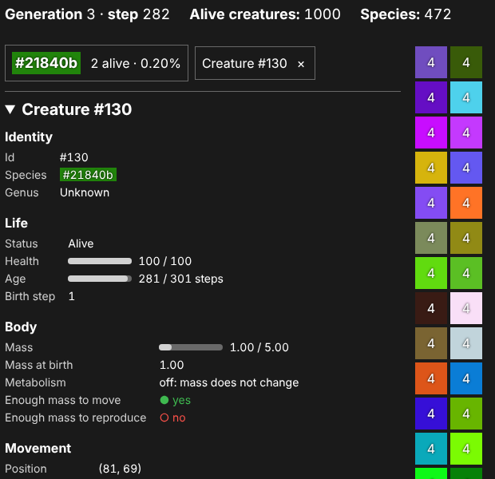
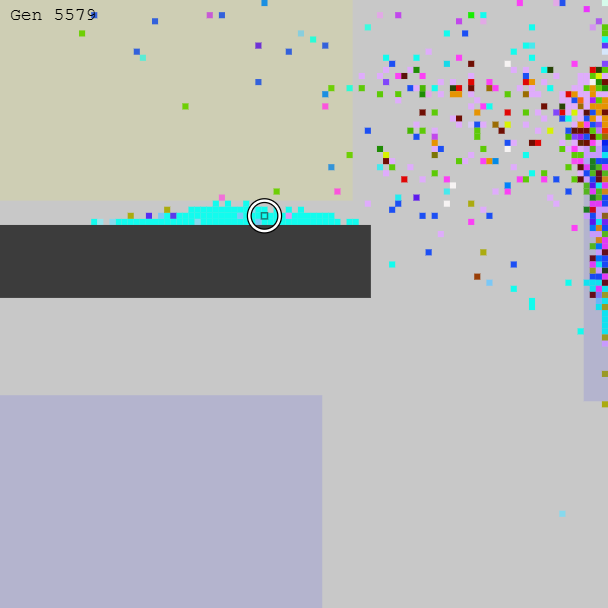
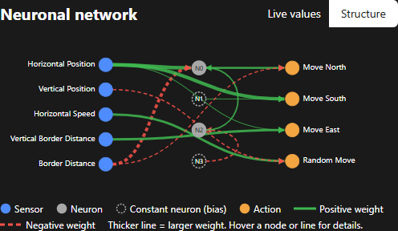
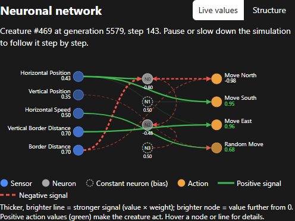
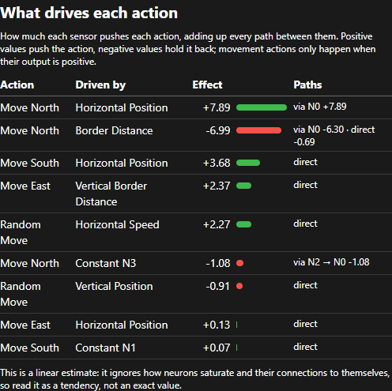

# Population and brains

The **Population** tab shows what is alive and how it thinks.

## Summary line

The line at the top shows the generation and step, how many creatures are alive and how many species there are. In scenarios with plants and animals it also counts the creatures of each genus. Everything is live except the number of species, which is counted at the start of each generation.

## Species

Creatures with exactly the same genome belong to the same **species**. Each species is shown with the same colour as its creatures on the world, so it follows the phenotype mode: with `genome` each species has a colour taken from its genome, and with `trophicLevel` it is a shade of green, blue or red for its genus.

- The coloured boxes on the right are the 42 largest species, counted at the start of the generation. Each box shows how many creatures the species has. A small letter in the corner shows the genus: **P** plant, **H** herbivore, **C** carnivore (no letter for `unknown`). Hover a box to see its colour code, genus and size.
- Click a box to select that species. Click it again to clear the selection.

Many species in the list have the same colour (in `trophicLevel` mode, species of the same genus have similar shades) and the same count. Usually these are close relatives that differ by one mutation.

## Selecting a creature

Click a creature in the world. This selects its species and draws a ring around it. Click an empty cell to clear the selection.

When a new generation starts, the selection moves to a creature of the same species. Offspring often mutate, so the species may have no members in the new generation. In that case the creature that shares the most genes with the old one is selected, usually a descendant with a single mutation, and its species becomes the selected species.

Pause the simulation, or set **Pause between steps** to 200, before you click. The creature you click is the one whose live values appear below. To clear only the creature and keep the species, use the **×** next to its name at the top of the panel.

## Layout of the panel

The top of the panel shows what is selected: the species (colour code, genus, alive creatures and percentage) and the creature. Below it, the information is grouped in sections that you can open and close by clicking their title:

| Section | Shown when | Open at first |
|---|---|---|
| **Creature #id** | a creature is selected | yes |
| **Neuronal network** | a species is selected | yes |
| **What drives each action** | a species is selected | yes |
| **Genome** | a species is selected | no |

A section you close stays closed when you select another species.

## Selected creature

The **Creature** section is updated at every step:

- **Identity**: id, species, genus, which genus it eats and is eaten by, and its parent (id and the generation the parent was born in; most selection methods restart the ids every generation).
- **Life**: alive or dead, health, age against the maximum age, and the generation and step it was born. In generational runs the maximum age is the length of the generation.
- **Body**: mass against the maximum mass, mass at birth and basal consumption per step. "Enough mass to move / reproduce / attack" tell whether the creature has the mass that each action needs ([Creatures](../model/creatures.md)). Without metabolism the mass never changes.
- **Movement**: position, last movement, direction, the distance index used by *Greatest Distance* selection (it is not the number of cells travelled), steps without moving, and the water in its cell.
- **Activity**: children, attacks and kills (for herbivores and carnivores), and the water it got from photosynthesis (with metabolism).
- **Brain**: genes, neurons and connections, and the action with the highest output in this step.

If the creature dies, the section says why (old age, out of mass, eaten and by which species, or health), when, and keeps the values of its last step. In generational runs most creatures do not die: they are replaced when the generation ends, and the section says so.

See [Life history](../model/creatures.md#life-history) for what each value counts.

## Selected species

- **Alive / percentage**: size of the species and its share of the creatures alive at the start of the generation. If every member has died, it shows **Extinct**.
- **Neuronal network**: the brain shared by every member of the species.
- **What drives each action**: a summary of the network.
- **Genome**: genome size and the raw genes in hexadecimal and binary. Use the clipboard button to copy them.

### Neuronal network: Structure view

The diagram reads from left to right:

- **Blue nodes** are the sensors the genome uses (see [sensors](../reference/sensors-and-actions.md#sensors)).
- **Grey nodes (N0, N1…)** are internal neurons.
- **Dashed grey nodes** are *constant* neurons. They have no inputs, so they always send the same value and act as a bias.
- **Orange nodes** are actions (see [actions](../reference/sensors-and-actions.md#actions)).
- **Green lines** are positive weights and **red dashed lines** are negative weights. Thicker lines mean larger weights.

Hover over a node or a line to see its exact value.

### Neuronal network: Live values view

When you have clicked a creature of the selected species, a **Live values** / **Structure** switch appears. **Live values** shows what the brain of that creature is doing at the current step.

- The value under each sensor is its current reading.
- The value under each action is its output. Green values (above 0) make the creature act.
- Brighter nodes and thicker lines carry stronger signals (value × weight).

Pause and step slowly to see how sensor readings turn into movement.

### What drives each action

The table lists every sensor that affects each action, sorted by strength:

- **Effect** adds up every path from the sensor to the action. Positive values push the action. Negative values hold it back.
- **Paths** shows whether the link is *direct* or goes *via* internal neurons.
- "Constant N2" means the input comes from a constant (bias) neuron, not from a sensor.

The table is a linear estimate: it ignores neuron saturation and self-connections. Read it as a tendency. In the example above, **Move North** is driven up by **Horizontal Position** and held back by **Border Distance**. Creatures on the right side of the map move north unless they are close to an edge.

## Genus

In scenarios with plants and animals, each creature also has a **genus** (plant, herbivore or carnivore). The genus depends on the actions in its genome, and the world can colour creatures by genus instead of by species. In most scenarios the genus is `unknown`, because none of those actions are enabled. See [Genus](../reference/sensors-and-actions.md#genus).
