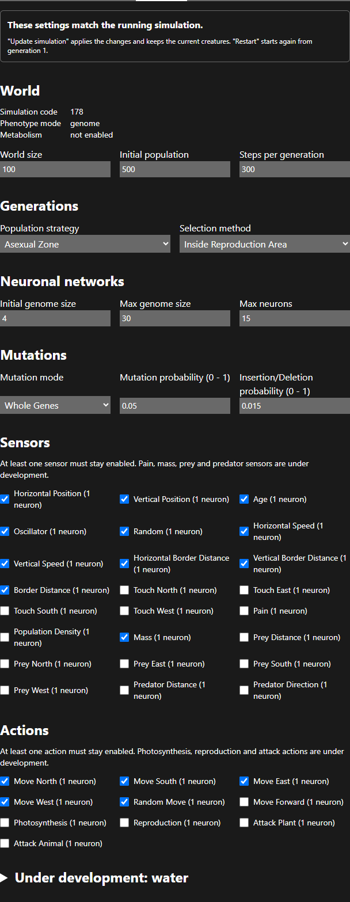
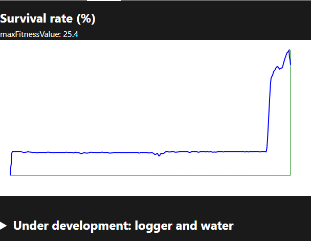

# Scenario, simulation and tools

Use **Scenario** to change the rules of a simulation, and **Simulation** for the options of the run itself, to see whether the change worked and to log species and creatures.

## Scenario

**Load scenario** at the top loads one of the demo scenarios (see [Scenarios](scenarios.md)), a `.sim` file or one of your saved scenarios (see [Export](export.md#load)). Below it, the settings are grouped in sections: World (world size, water and the map editor), Generations, Neuronal networks, Mutations, Sensors, Actions and Constants. Every field is described in the [parameters reference](../reference/parameters.md).

Every section starts closed: click its title to open or close it. The tab remembers which sections are open while the browser tab stays open, also when you switch to another tab or reload the page. A section whose fields differ from the running simulation shows **● not applied** next to its title, so you can see where the pending changes are without opening every section. The bar with **Update simulation**, **Restart** and **Discard changes** stays outside the sections, always visible.

**Constants**, at the end, lists every value of the constants file and the model constants (mass, stamina, reproduction, movement and attack), one per line: name, field and a short description, grouped by topic. They are applied with **Update simulation** or **Restart** like the other settings, except the **Log** group, which applies at once as in *Simulation → Log*. Map colors accept any CSS color; the map editor shows them at once, and they apply to every obstacle and area of the map.

After a scenario or file is loaded, **Top species in the loaded file** at the end of the tab opens and lists up to 10 species with most creatures in it, most numerous first, leaving out those with less than 1% of the creatures. Each one shows its share of all the creatures in the file (%), its number of creatures and its hexadecimal genome, with a button that copies the genome. A line below the list sums up the species left out: how many there are, their share and their creatures. The list describes the file as it was loaded and does not change while the run goes on. A setup file has no creatures, so the section says so instead.

### Applying changes

Your edits are a **draft**. The simulation keeps running with its old settings until you apply them. When the draft differs from the running simulation, the bar above the settings says "You have changes that are not applied yet" and offers three buttons:

| Button | Effect |
|---|---|
| **Update simulation** | Applies the changes and keeps the current creatures, generation number and stats. Use it to adjust a run that is in progress. |
| **Restart** | Applies the changes and starts again from generation 1. |
| **Discard changes** | Goes back to the settings of the running simulation. |

Some changes behave differently depending on how you apply them:

- **World size and map:** **Update simulation** rebuilds the world straight away. Creatures that no longer fit are removed: those outside a smaller world, or on a cell that is now an obstacle.
- **Initial population** and the population strategy take effect when the next generation is created. Choosing *Random Fixed Genera* or *Plants and Animals* also enables the actions their genera need (Photosynthesis, Attack Plant, Attack Animal, and Reproduction for all of them) and turns metabolism on, so use **Restart** after choosing them (see Sensors and actions below). With *Random Fixed Genera*, the **Genera of generation 1** box lets you see and change the probability of each genus, and so how generation 1 genomes are built ([details](../reference/population-and-selection.md#random-fixed-genera-randomfixedgenepopulation)).
- **Simulation type:** with **Update simulation**, the current creatures carry on in the new mode, and the change takes effect at the end of the current generation. In continuous mode, the tab warns you if no creature can be born: metabolism is off, or the Reproduction action is not enabled.
- **Water** (in World): the water settings check its settings against the world size and the initial population. Generation 1 takes its mass from the total water before the first rain, so if even the smallest mass at birth times the initial population is more than the world's total water, the World section shows the error in red and **Update simulation** and **Restart** are disabled until you fix it. It also warns, without disabling anything, when only the lighter genera fit, when the cells will start with less than *Initial water per cell*, and when *Rain max per cell* is above *Total water (per cell)* in a generational run, so it never rains.
- **Metabolism** (at the top of Generations): with **Update simulation**, the creatures keep their current mass and start gaining or losing it from the next step. With metabolism on, *Inside Reproduction Area* cannot be chosen as the selection method; turning metabolism on while it is selected switches to *Reproduction*, and a notice below the checkbox says so.
- **Selection method:** the text below the selector says what the selected method does.
- **Sensors and actions:** each enabled sensor and action has a **Cost** field below it: the mass a brain spends in each step it runs for reading that sensor or being connected to that action. It starts at 0. Genes point to sensors and actions by their position in the list of enabled items. If you change the list and click **Update simulation**, the genes of the living creatures are rewritten so that their brains stay the same ([details](../reference/sensors-and-actions.md#changing-the-decoding-during-a-run)).
- **Max neurons:** with **Update simulation** the brains stay the same too. The new neurons are used as mutations reach them.
- **Disabling a sensor or action, or lowering Max neurons:** these can change some brains. Genes that use a disabled sensor or action are deleted, and neurons not below the new Max neurons connect to another neuron. The bar above the settings says how many creatures would get a different brain before you apply the changes.
- **Invalid values:** a field rejects a value out of range and shows the allowed range. When you leave the field, it goes back to the last valid value.

### Ideas to try

| Experiment | Change |
|---|---|
| Does evolution still work with fewer mutations? | Set Mutation probability to 0.001 and restart. |
| Do bigger brains solve harder maps? | Raise Max genome size to 16 and Max neurons to 4. |
| How much does a single sense matter? | Disable Horizontal Position and restart. |
| Reward travelling instead of a place | Selection method: Greatest Distance. |
| Harder goal | Make the reproduction area smaller in the [Map editor](map-editor.md). |

## Simulation

The options of the running simulation. They have no draft: a change applies at once, also while paused, and never shows as a pending change in the Scenario tab. **Update simulation** and **Restart** keep them.

There are three collapsible sections, closed at first (click a title to open it): **Run** has the simulation code, the seed and the phenotype mode, and the other two show how the run is going.

- **Simulation code:** a name for the run, used in the names of saved files, images, GIFs and logs. Changing it renames the running simulation straight away. **Restart**, and the automatic restart after an extinction, keep a code you chose. They also keep the code when the seed is fixed and the scenario has not changed, because the restart repeats the same simulation. Otherwise they pick a new random one.
- **Fixed seed:** off, every **Restart** picks a new random seed. On, every **Restart** repeats the same simulation (same settings and map); change the number to get another one. Turning it on fills in the seed of the running simulation, and **Fix this seed** does the same later, so you can repeat a run you liked. The seed only takes effect at the next **Restart**: the running simulation keeps its random sequence.
- **Phenotype mode** only changes how creatures are coloured: by genome, so each species has its own colour; by trophic level (green plants, blue animals); or with green plants, where plants are shades of green and every other species has its own colour that is not green. The creatures are recoloured straight away.

### Fitness chart

The section title is the name of the fitness value, for example **Survival rate (%)**. The chart plots the **fitness value** of every generation. The selection method defines what fitness means, and the chart title changes with it:

| Selection method | Chart title | Meaning |
|---|---|---|
| Inside Reproduction Area | Survival rate (%) | Share of the population that survived |
| Greatest Distance | Distance index | Longest distance covered |
| Greatest Mass | Greatest mass | Heaviest animal |
| Reproduction | Reproduction | Number of survivors |
| *(continuous runs)* | Population | Creatures alive at the end of the generation. The births and deaths of the last generation are shown above the chart. |

**maxFitnessValue** above the chart is the value of the last generation. The curve is smoothed.

Below the chart, **Total time** is the time spent running the simulation, **Last generation duration** is how long the last generation took to compute, and **Steps per second** is how many steps were computed during the last second. Use it to compare the speed controls: the step counter of the control bar is redrawn at most once per frame, so it looks the same at very different speeds.

Typical shapes:

- **A long flat start, then a jump.** The population found a strategy by chance and it spread. In the screenshot, the jump is where the loaded run reached generation 5574.
- **A plateau below 100%.** The current brains have hit their limit. More genes or neurons, or more time, may help.
- **A sudden drop.** A change to the settings or the map made the old strategy useless.

### Water

Shows how the world's water is split between the cloud, the cells and the creatures. It only changes when metabolism is enabled. **Show water in cells** paints every empty cell of the world from grey (no water) to blue (full), by its water as a percentage of the cell's capacity. It is a viewer option: it is off when the app opens, it is not saved with the simulation, and it redraws the world at once, also while paused. Because it is drawn on the world canvas, GIFs recorded while it is on show the water too.

### Log

The **Log** section saves tables of species and creatures as CSV files, one row per species or creature, to analyse a run outside the app (a spreadsheet, Power BI, Python). Every save also downloads a file with the settings of the simulation and a `.sim` with the simulation as it is then (not after a restart or a load, when it is another run), to load it later or open it in the energy lab page. What each file contains, column by column, is in [The log files](../reference/log-file.md).

A species here is a lineage: creatures with the same genome **and** the same origin. The same genome reached from two different species is two species. See [Species](population-and-brains.md#species).

- **Files**: **Species** and/or **Creatures**.
- **Which ones**: **All**, or **Marked in Population**: the species and creatures marked with **Mark for log** in the Population tab. The marked ones are listed below, with **×** to unmark one and **Clear marks**. With marked species, the file of creatures has their creatures too. The marks are not saved with the simulation.
- **Save snapshot** downloads the files of this moment: the species of the current generation and the living creatures (and, with **Creatures: also the dead**, the ones that died in this generation).

A **recording** adds rows at the end of every generation until it is stopped. Choose **From** (*Now*, or *Generation 1*, which restarts the simulation like **Restart** and records from its first step) and press **Start recording**. While it records, the button is **Stop recording**.

- **Recording** says what it is doing: *Recording*, *Stopped*, *Stopped: the recording reached Maximum rows*, or *Stopped: the simulation was restarted or loaded*. After a restart, **Continue recording** goes on with the same recording; its generations start again at 1.
- **Rows**, out of **Maximum rows**, with *(not saved)* when there are rows that have not been saved, and the **Generations** in it.
- **Save recording** downloads its files; **Delete recording** deletes it. **Start recording** and **Delete recording** ask first when there are rows that have not been saved.

To draw the tree of species over time, record the species from *Generation 1* with **All**: every species seen in a generation gets a row at its end, also the ones that died out, with the species it came from. Then open the file in the **species tree** page, linked from the section ([details](../reference/log-file.md#drawing-the-tree-of-species)).

**Options** (the `LOG_*` constants) apply at once, also while paused, and are saved with the simulation; the Scenario tab does not show them as pending changes. A recording keeps the options it started with.

- **Also every (steps)**: a recording also writes rows every this many steps. 0 (the default) writes only at the end of each generation.
- **Creatures: also the dead** (default on): a recording writes each creature that dies once, after its death; a snapshot writes the ones that died in this generation.
- **Creatures: genome** adds the genome of each creature. It is always in the file of species.
- **Species: list of living creatures** adds the keys of the living creatures of each species.
- **Number format** sets the decimal separator: `es-ES` (1,5) or `en-US` (1.5).
- **Maximum rows**: a recording stops at this many rows.

Each file is a separate download, so the browser may ask once whether the page can download several files.
