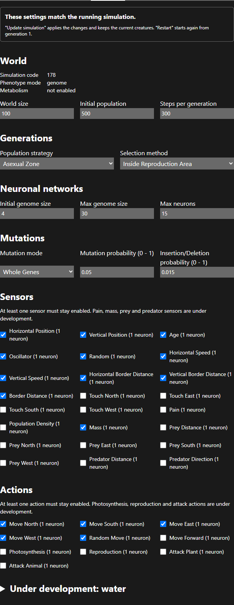
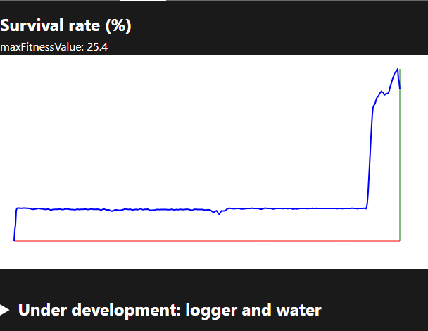

# Settings and stats

Use **Settings** to change the rules of a simulation and **Stats** to see whether the change worked.

## Settings

The tab is grouped in sections: World, Generations, Neuronal networks, Mutations, Sensors, Actions and Water. Every field is described in the [parameters reference](../reference/parameters.md).

### Applying changes

Your edits are a **draft**. The simulation keeps running with its old settings until you apply them. When the draft differs from the running simulation, the bar at the top says "You have changes that are not applied yet" and offers three buttons:

| Button | Effect |
|---|---|
| **Update simulation** | Applies the changes and keeps the current creatures, generation number and stats. Use it to adjust a run that is in progress. |
| **Restart** | Applies the changes and starts again from generation 1. |
| **Discard changes** | Goes back to the settings of the running simulation. |

Some changes behave differently depending on how you apply them:

- **World size and map:** **Update simulation** rebuilds the world straight away. Creatures that no longer fit are removed: those outside a smaller world, or on a cell that is now an obstacle.
- **Initial population** and the population strategy take effect when the next generation is created. Choosing *Random Fixed Gene* or *Plant/Herbivore* also enables the actions their genera need (Photosynthesis, Attack Plant, Attack Animal, and Reproduction for all of them) and turns metabolism on, so use **Restart** after choosing them (see Sensors and actions below).
- **Simulation type:** with **Update simulation**, the current creatures carry on in the new mode, and the change takes effect at the end of the current generation. In continuous mode, Settings warns you if no creature can be born: metabolism is off, or the Reproduction action is not enabled.
- **Phenotype mode** only changes how creatures are coloured. **Update simulation** recolours them straight away.
- **Metabolism:** with **Update simulation**, the creatures keep their current mass and start gaining or losing it from the next step.
- **Simulation code:** **Update simulation** renames the running simulation. **Restart** keeps the code only if you changed it; otherwise it picks a new random one.
- **Sensors and actions:** genes point to sensors and actions by their position in the list of enabled items. If you change the list and click **Update simulation**, existing brains are rewired. Use **Restart** unless that is what you want.
- **Invalid values:** a field rejects a value out of range and shows the allowed range. When you leave the field, it goes back to the last valid value.

### Ideas to try

| Experiment | Change |
|---|---|
| Does evolution still work with fewer mutations? | Set Mutation probability to 0.001 and restart. |
| Do bigger brains solve harder maps? | Raise Max genome size to 16 and Max neurons to 4. |
| How much does a single sense matter? | Disable Horizontal Position and restart. |
| Reward travelling instead of a place | Selection method: Greatest Distance. |
| Harder goal | Make the reproduction area smaller in the [Map editor](map-editor.md). |

## Stats

The chart plots the **fitness value** of every generation. The selection method defines what fitness means, and the chart title changes with it:

| Selection method | Chart title | Meaning |
|---|---|---|
| Inside Reproduction Area | Survival rate (%) | Share of the population that survived |
| Greatest Distance | Distance index | Longest distance covered |
| Greatest Mass | Greatest mass | Heaviest herbivore |
| Reproduction | Reproduction | Number of survivors |
| *(continuous runs)* | Population | Creatures alive at the end of the generation. The births and deaths of the last generation are shown above the chart. |

**maxFitnessValue** above the chart is the value of the last generation. The curve is smoothed.

Below the chart, **Total time** is the time spent running the simulation, **Last generation duration** is how long the last generation took to compute, and **Steps per second** is how many steps were computed during the last second. Use it to compare the speed controls: the step counter of the control bar is redrawn at most once per frame, so it looks the same at very different speeds.

Typical shapes:

- **A long flat start, then a jump.** The population found a strategy by chance and it spread. In the screenshot, the jump is where the loaded run reached generation 5574.
- **A plateau below 100%.** The current brains have hit their limit. More genes or neurons, or more time, may help.
- **A sudden drop.** A change to the settings or the map made the old strategy useless.

### Water

Shows how the world's water is split between the cloud, the cells and the creatures. It only changes when metabolism is enabled. **Show water in cells** paints every empty cell of the world from grey (no water) to blue (full), by its water as a percentage of the cell's capacity. It is a viewer option: it is off when the app opens, it is not saved with the simulation, and it redraws the world at once, also while paused. Because it is drawn on the world canvas, GIFs recorded while it is on show the water too.

### Under development: logger

Expand this section to see the **logger**. It records creature events (births, moves, deaths, attacks…) and saves them as a `.csv` file. The buttons record the first generation, the next generation, or everything from the first generation on. **Creature to log** filters by creature id: `0` logs all creatures, `-10` logs creatures 0 to 9, and any other number logs that single creature. **Log this creature** in the Population tab fills this field with the selected creature. A Power BI report to analyse the log is in `public/analyze simlog.pbix`.

**Logger options**, below it, change the logger settings (the `LOG_*` constants). They apply at once, also while paused, and are saved with the simulation. Settings does not show them as pending changes, and **Update simulation** and **Restart** keep them.

- **Enable logger** turns the logger on or off. When it is off, the rest of the section is hidden.
- **Level** chooses which rows go into the file. *Creature events and all totals* writes one row per creature event plus the totals. *Step totals…* writes, for each step, how many times each creature event happened, plus the generation totals and the world events. *Generation totals…* writes only the counts per generation and the world events. *World events only* writes only the population and water rows of the world. The totals count only the creatures that pass **Creature to log**.
- **Maximum events** is the number of rows at which the logger pauses.
- **Number format (locale)** sets the decimal separator of the values, for example `es-ES` (1,5) or `en-US` (1.5). Unknown locales are ignored.
- **Events to record** turns each event type on or off. A creature event that is off is not counted in the totals either.

**Log this creature** sets the level to *Creature events* for the logger only: the saved setting does not change until you choose a level here.
